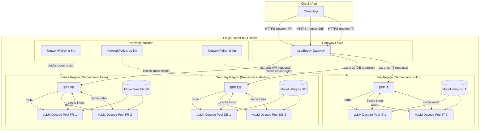

# Ensuring AI Sovereignty in Distributed Inference  
## Preventing Cross-Region Routing, KV-Cache Leakage, and Auditing Gaps with llm-d, vLLM, and OpenShift

**Version:** 1.0  
**Audience:** Platform architects, SREs, AI infrastructure engineers, compliance and security teams  
**Date:** October 2025

---

## Abstract

As large language models (LLMs) become critical infrastructure, enterprises and public-sector organizations must reconcile *AI sovereignty* requirements with the operational realities of hybrid cloud. Sovereignty is not only about data residency; it also encompasses *routing isolation*, *inference state hygiene*, and *provable auditability* across regions and tenants. This white paper presents a Kubernetes-native architecture using **llm-d** (Large Language Model Disaggregator) and **vLLM** on **Red Hat OpenShift** that prevents three standard failure modes in sovereign environments: (1) *accidental cross-region routing*, (2) *KV-cache leakage across jurisdictions or tenants*, and (3) *auditing gaps that hinder compliance evidence*. We describe an **EPP-centric** (External Processing Pod) design relying on gateway-side hashing, lightweight per-pool cache indexes, and policy-driven scoring—to deliver *prefix/KV-aware* routing with firm regional boundaries and deep observability. The paper includes an implementation blueprint, operational SLOs, and a regionally compliant logging and tracing approach aligned to OpenShift’s zero-trust and secure supply chain controls.

---

## 1. Introduction

Governments and regulated industries increasingly require that AI systems respect jurisdictional boundaries for personal and sensitive data. In practice, this means that *inference*—not just training—must be *region-aware* and *auditable*. Standard API gateways and monolithic inference servers provide insufficient control: stateless routing can misplace workloads, shared KV-caches can leak prompt context across tenants or countries, and logs often lack the end-to-end traceability needed for compliance attestations.

This paper focuses on **distributed inference** using **llm-d** and **vLLM** on **OpenShift**. We assume a pragmatic goal common to sovereign deployments: **one set of weights per region (same digest, attested provenance)** to keep cost manageable, but **strictly separate KV-caches, routing planes, and observability backends** per jurisdiction. Our scope spans the control plane (routing, policy, admission) and the data plane (prefill/decode, KV-cache reuse, token streaming), emphasizing operational guardrails and compliance-ready evidence.

**Key contributions of this paper:**
- An **EPP-centric**, architecture for prefix/KV-aware routing.  
- A *defense-in-depth* approach to prevent cross-region routing and KV leakage.  
- An observability model and SLO set oriented to sovereign AI operations.

---

## 2. Background and Requirements

### 2.1 Sovereign AI in Practice
Sovereignty regimes (e.g., GDPR, national data-localization laws) impose constraints on *where* data is processed and *how* derived artifacts are handled. In LLM serving, derived artifacts include **KV-cache blocks**, **prefix indexes**, and **request traces**. These artifacts must be *localized* and *non-transferrable* across sovereign boundaries while preserving performance and cost efficiency.

### 2.2 vLLM and llm-d Overview
- **vLLM** provides the *engine-level* capabilities—**PagedAttention**, **continuous batching**, **prefix caching**, and **distributed parallelism**—that make high-throughput, low-latency inference viable.
- **llm-d** contributes the *platform-level* controls—**inference gateway**, **EPP**, **prefill/decode disaggregation**, **policy-driven scheduling**, and **first-class telemetry**—that transform a single fast server into an operable, compliant multi-region service.

### 2.3 OpenShift as the Sovereign Substrate
OpenShift provides (1) **zero-trust networking** (mTLS, SPIFFE/SPIRE), (2) **secure supply chain** (image signing, provenance), (3) **multi-tenancy and isolation** (namespaces, NetworkPolicy, SCC/SELinux), and (4) **fleet-level governance** (ACM/GitOps). These primitives are critical for proving that routing and state never cross forbidden boundaries.

---

## 3. Threats and Failure Modes

### 3.1 Accidental Cross-Region Routing
**Problem:** Stateless L7 routing (round-robin/least-connections) ignores region, tenant, cache locality, SLO class.  
**Impact:** Requests from jurisdiction A land on a pool in jurisdiction B, violating data residency and customer contracts.  
**Root causes:** Incomplete request metadata; gateways unaware of sovereign policy; lack of region pinning; ambiguous pool labels.

### 3.2 KV-Cache Leakage
**Problem:** KV-cache or prefix reuse occurs across region/tenant boundaries.  
**Impact:** *Context cross-pollination*—subsequent requests benefit from (and possibly infer) prompts originating in other regions; audit risk.  
**Root causes:** Shared cache index; non-partitioned KV metadata; global side-channels; rehydration/fallback that crosses policy lines.

### 3.3 Auditing Gaps
**Problem:** Missing or non-correlatable logs and traces for routing and KV usage.  
**Impact:** Compliance evidence cannot be produced; incident root-cause is guesswork.  
**Root causes:** Disconnected observability; lack of region/tenant tags; opaque gateway logic; no “decision trail” from gateway → scheduler → pod.

---

## 4. Architectural Overview (EPP-Centric)

We present a design that the **EPP** maintains an *in-memory view* of per-pool cache “cache indexes” (lightweight Bloom filters or top-K hot prefixes) published by each decode pool’s **routing sidecar**. Requests are annotated at the gateway with **normalized prefix hashes**, and the EPP uses *policy-weighted scoring* to select a pool **within the same region** that most likely holds useful KV.

### 4.1 Design Principles
- **Locality by default:** No inter-region cache metadata; no global state.  
- **Probabilistic but confirmable:** Cache indexes reduce overhead; optional *pre-route probes* confirm a match.  
- **Policy first:** Region pinning, tenant isolation, and SLO class are *hard constraints*; KV affinity is an optimization.  
- **Composable:** Works alongside vLLM (prefix caching) and OpenShift (network and identity controls) without custom forks.

### 4.2 Primary Components (Logical)
- **Envoy + Gateway API:** Normalizes requests, computes prefix block hashes (aligned to vLLM block size), calls **EPP** via ext-proc.  
- **EPP (External Processing Pod):** Applies **region/tenant constraints**, evaluates **cache-index** and **load/SLO scorers**, optionally probes a candidate, returns route.  
- **Routing Sidecar (per decode pod):** Streams *cache indexes* (and health/epoch) to the EPP over gRPC; handles optional “has-prefix?” probe.  
- **vLLM Worker:** Executes inference with **prefix caching**, **PagedAttention**, **continuous batching**; KV lives and dies in-pod (or local shared memory), never crossing regions.  
- **Observability Stack:** Prometheus + OpenTelemetry + Grafana/Tempo, with **region/tenant/pool labels** everywhere.

---

## 5. Sovereign Multi-Region Diagram (Markdown/Mermaid)



**Reading the diagram:** Within a single OpenShift cluster, each sovereign region is isolated using Kubernetes namespaces and NetworkPolicies. A shared gateway routes requests to the appropriate regional EPP based on region metadata. Decode pools stream *local* cache indexes to their regional EPP only. **No cross-region** cache metadata or KV transfer exists within the cluster. The same model weights (same hash/digest, separately stored per namespace) are loaded per region, ensuring complete isolation despite sharing cluster infrastructure.

---

## 6. Preventing Accidental Cross-Region Routing

### 6.1 Region Pinning at the Edge
- **Ingress FQDN per region** (e.g., `llm.fr.example.com`) and/or JWT claims define `req.region`.  
- The **EPP** enforces a *candidate pool filter*: `pool.region == req.region`. This is a **hard constraint**; KV affinity cannot override it.

### 6.2 Policy-Driven Scoring
Within the region, the EPP scores candidates by:
- **prefix_cache_index score** (probabilistic overlap between request prefix hashes and local cache indexes),  
- **load score** (queue depth, GPU headroom, historical TTFT/TPOT),  
- **SLO class weight** (latency budgets by tier),  
- **optional confirm**: “has-prefix?” probe to the best candidate (fast gRPC sidecar check) to avoid false positives.

### 6.3 Failure Handling
- **Stale cache indexes** lower confidence; the EPP gracefully falls back to *load/SLO-only* routing within the region.  
- **Gateway retries** stay in-region by policy; no cross-region fallback is permitted unless explicitly configured for *legal equivalence zones* (e.g., EU-only).

---

## 7. Eliminating KV-Cache Leakage

### 7.1 Local-Only KV
- KV blocks reside in the **vLLM pod memory** or node-local shared memory—never replicated beyond the region.  
- **No side-channel** for KV transfer across regions; intra-region P/D disaggregation is permitted but constrained by NetworkPolicy.

### 7.2 Cache indexes, Not State
- Routing sidecars export **compact cache indexes** (e.g., Bloom/top-K) of *what* is cached, not the cache content.  
- Cache index streams are **confined in-region** (service mesh policies), and carry **short TTLs** to avoid stale routing.

### 7.3 Namespaces and Pools
- Each jurisdiction uses dedicated **namespaces**, **service accounts**, **NetworkPolicies**, and **SCC profiles**.  
- Model weights are mounted **read-only**; caches and telemetry targets are namespace-local.

---

## 8. Closing Auditing Gaps

### 8.1 Decision Trails
- The EPP logs **inputs → scores → selected pool** with `region`, `tenant`, `slo_class`, `cache_index_confidence`, and *probe result* when used.  
- Each Envoy ext-proc call carries a **correlation ID** propagated into OTel spans.

### 8.2 Sovereign Observability
- All metrics and traces are labeled with `region`, `tenant`, `pool`, `replica`.  
- Region-local Prometheus/Tempo ingest raw telemetry; cross-region roll-ups are *derived* aggregates (no prompts, no KV metadata).

### 8.3 Evidence for Compliance
- Dashboards visualize **TTFT/TPOT**, **routing latency**, **goodput vs. SLO**, **cache hit ratio** per region/tenant.  
- Signed, immutable logs (e.g., with Loki retention policies) provide **tamper-evident** records for audits.

---

## 9. Implementation Blueprint on OpenShift

### 9.1 Placement and Identity
- **One OpenShift cluster per jurisdiction** (or strong node pool partitioning with taints/tolerations).  
- **SPIFFE/SPIRE** issues workload identities; mTLS enforced by the mesh.

### 9.2 Gateway + EPP Integration (Conceptual YAML Sketch)
```yaml
# Envoy ext-proc → EPP gRPC service (conceptual)
extProc:
  grpcService:
    envoy_grpc:
      cluster_name: epp.fr.svc
processingMode:
  requestHeaderMode: SEND
  requestBodyMode: BUFFERED
# Edge pre-processor adds prefix block hashes aligned to vLLM block size.
```

### 9.3 EPP Scoring Profile (Conceptual)
```yaml
epp:
  constraints:
    - type: region_pin
      rule: "pool.region == req.region"
  scorers:
    - name: prefix_cache_index
      weight: 1.5
      config: { ttl_ms: 1500, confirm_probe: true }
    - name: load
      weight: 1.0
    - name: slo_class
      weight: 0.5
```

### 9.4 Decode Pool with Routing Sidecar (Conceptual)
```yaml
containers:
- name: routing-sidecar
  image: ghcr.io/llm-d/llm-d-routing-sidecar:latest
  args: ["--export-cache-index", "--export-interval=500ms",
         "--epp-grpc=epp.fr.svc:9002", "--cache-index-type=bloom",
         "--hash=sha256", "--block-size=16"]
- name: vllm
  image: ghcr.io/llm-d/llm-d:vX.Y.Z
  args: ["--enable-prefix-caching", "--prefix-caching-hash-algo", "sha256",
         "--block-size", "16", "--gpu-memory-utilization", "0.9"]
```

### 9.5 Network and Policy
- **NetworkPolicy** denies cross-namespace traffic by default; only EPP↔sidecar within region is permitted.  
- **SCC/SELinux** profiles restrict host access; volumes for model weights are read-only.  
- **GitOps/ACM** enforce region-specific policy bundles and sign all release artifacts.

---

## 10. Operational SLOs and Runbook

### 10.1 SLOs that Matter
- **TTFT P95/P99** per region/tenant/pool  
- **TPOT P95** and **end-to-end latency**  
- **Cache Hit Ratio** and **reuse length** (per region)  
- **Routing Latency** and **match confidence**  
- **Goodput**: % of requests meeting SLOs

### 10.2 Alerts and Runbook Steps
- **Cross-Region Violation Alert:** trigger when any route decision logs `pool.region != req.region` (should be impossible under constraints).  
- **Cache Index Staleness:** alert when `cache_index_age_seconds > ttl_ms`; EPP will down-weight prefix scorer automatically.  
- **Cache Fragmentation:** falling hit ratio → consider traffic shaping or prompt templates per tenant to improve locality.  
- **GPU Headroom:** proactive autoscale based on queue depth + GPU mem headroom to keep TTFT within SLO.

---

## 11. Case Study: Three-Nation Sovereign Cloud

**Context:** One LLaMA-class model (identical digest) deployed across **France**, **Germany**, **Italy**.  
**Goal:** Share weights to control cost; absolutely avoid cross-border routing and KV sharing.

**What we deployed:**
- 3 OpenShift regions with their own Gateways, EPPs, decode pools, observability stacks.  
- Gateway URLs: `llm.fr.example.com`, `llm.de.example.com`, `llm.it.example.com`.  
- EPP policy: `pool.region == req.region` (hard constraint).  
- Sidecars stream local cache indexes to EPP
- vLLM uses `--enable-prefix-caching --prefix-caching-hash-algo sha256 --block-size 16`.

**Outcomes (representative):**
- **0 cross-region routes** observed (enforced by constraint + NetworkPolicy).  
- **Cache hit ratio** stabilized at 65–85% depending on per-tenant prompt locality.  
- **TTFT P95** improved 30–50% compared to load-only routing, with negligible EPP overhead.  
- Audit dashboards show complete **request → decision → pool** traces per jurisdiction.

---

## 12. Discussion and Limitations

- **Why no Redis?** Removing a central index reduces operational and compliance risk; cache indexes + optional probes strike a balance between accuracy and simplicity.  
- **Trade-off:** Cache locality is regional rather than global; this is a *feature* in sovereignty scenarios.  
- **Large MoE models:** llm-d can compose with vLLM’s distributed features (TP/PP; EP/DP where applicable). Keep expert/gating traffic intra-region.  
- **Future:** Policy-as-code integration (OPA/Gatekeeper) for EPP constraints; confidential compute and attested enclaves for routing plane components.

---

## 13. Conclusion

Sovereign AI is not only about where data sits—it is about **how requests move**, **where ephemeral inference state lives**, and **how operators prove compliance** without sacrificing performance. An **EPP-centric** llm-d architecture—eschewing global indexes in favor of *local cache indexes, policy-driven scoring, and strict region pinning*—yields strong guarantees against cross-region routing and KV leakage. Coupled with **vLLM** for efficient engine-level performance and **OpenShift** for zero-trust and secure supply chain controls, this blueprint enables practical, auditable, and cost-effective sovereign LLM inference across a hybrid cloud.

---

## References (APA 7th)

European Commission. (2024). *Regulation of the European Parliament and of the Council laying down harmonised rules on artificial intelligence (AI Act).* https://eur-lex.europa.eu/

European Data Protection Board. (2024). *Guidelines on processing of personal data in AI systems.* https://edpb.europa.eu/

Envoy Proxy. (2025). *External processing filter (ext_proc) documentation.* https://www.envoyproxy.io/

Kubernetes SIG-Network. (2025). *Gateway API.* https://gateway-api.sigs.k8s.io/

NIST. (2023). *AI Risk Management Framework 1.0.* https://www.nist.gov/itl/ai-risk-management-framework

OpenTelemetry. (2025). *Tracing specification.* https://opentelemetry.io/

Prometheus Authors. (2025). *Prometheus documentation.* https://prometheus.io/

Red Hat. (2024). *OpenShift security and compliance: Zero trust, supply chain, and workload identity.* https://docs.openshift.com/

vLLM Team. (2025). *vLLM documentation: PagedAttention, continuous batching, prefix caching, distributed serving.* https://docs.vllm.ai/

llm-d Project. (2025). *KV-cache wins you can see: From prefix caching in vLLM to distributed scheduling with llm-d.* https://llm-d.ai/blog/kvcache-wins-you-can-see

Zhou, M., Lin, P., & Sharma, A. (2024). Distributed inference for large language models in multi-tenant environments. *arXiv preprint* arXiv:2403.12211. https://arxiv.org/abs/2403.12211

